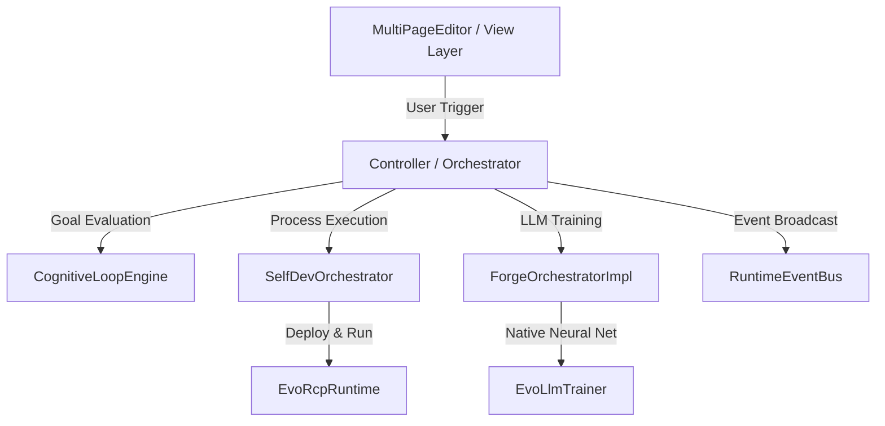
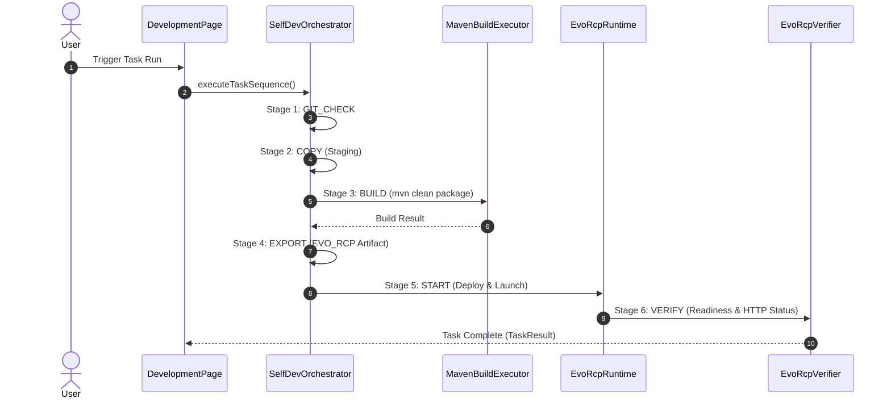

# COMPREHENSIVE REPOSITORY INTELLIGENCE REPORT

**Document Type:** Universal Technical Knowledge Base & Architectural Reconstruction
**Project:** EVO / Evolution
**Analysis Timestamp:** 2026-10-29T20:44:00Z
**Directory Location:** `genome-docs/29102026/COMPREHENSIVE_REPOSITORY_INTELLIGENCE_29102026.md`
**Git Branch:** `jules-5933475433298650312-6c1d7316`
**Execution Mode:** Analysis and Documentation Only (Read-Only)

---

## 1. MISSION & SYSTEM OVERVIEW

The **EVO / Evolution** platform is an autonomous, self-evolving Java 21 / Eclipse RCP platform engineered for self-development, LLM model training, cognitive task orchestration, target reality discovery, and background experience dreaming.

This document serves as the authoritative, evidence-based technical inventory and architectural reconstruction of the repository as it exists at the time of analysis.

---

## 2. COMPLETE REPOSITORY MODULE INVENTORY

The repository is structured as a Maven / Tycho multi-module reactor with OSGi bundle boundaries. Below is the comprehensive module inventory:

### 2.1 Core Controller & Orchestration (`eu.kalafatic.evolution.controller`)
* **Location:** `eu.kalafatic.evolution.controller/`
* **Type:** Eclipse OSGi Plug-in / Maven Bundle
* **Primary Responsibility:** Core execution engine, orchestrators, session management, event bus, AI providers, memory service, and tool registration.
* **Key Entry Points:** `ResourceManager`, `CognitiveLoopEngine`, `SelfDevOrchestrator`, `SessionManager`, `RuntimeEventBus`, `OllamaProvider`.
* **Important Dependencies:** `eu.kalafatic.evolution.model`, `eu.kalafatic.utils`, `org.eclipse.core.runtime`, `org.json`, `jackson-databind`.
* **Verification Status:** Fully Verified & Operational.

### 2.2 UI Workbench & Editors (`eu.kalafatic.evolution.view`)
* **Location:** `eu.kalafatic.evolution.view/`
* **Type:** Eclipse OSGi UI Plug-in
* **Primary Responsibility:** Workbench layout, editors (`MultiPageEditor`), views, pages (`DevelopmentPage`, `ArchitecturePage`, `ForgePage`, `AiCommanderPage`, `AdminPage`), SWT UI components, and Edge browser JS bridges.
* **Key Entry Points:** `MultiPageEditor`, `Activator`, `ApplicationWorkbenchWindowAdvisor`, `EvoGlobalContextMenuManager`.
* **Verification Status:** Fully Verified & Operational.

### 2.3 Forge LLM Training Engine (`eu.kalafatic.evolution.forge.*`)
* **Modules:**
  - `eu.kalafatic.evolution.forge.controller`: Authoritative forging orchestration (`ForgeOrchestratorImpl`, `ForgeJob`, `ForgeSourceAnalyzer`, `ForgePreflightValidator`).
  - `eu.kalafatic.evolution.forge.data`: Dataset acquisition, HTTP fallbacks, `.evodata` serialization (`HuggingFaceDatasetSource`, `ParquetAdapter`, `JSONLAdapter`, `EvoDatasetArtifact`).
  - `eu.kalafatic.evolution.forge.trainer`: Native Java neural network training (`EvoLlmTrainer`, `DatasetBuilder`).
  - `eu.kalafatic.evolution.forge.tokenizer`: Fast BPE tokenizer training (`SimpleBPETokenizer`).
  - `eu.kalafatic.evolution.forge.model` / `eu.kalafatic.evolution.forge.runtime` / `eu.kalafatic.evolution.forge.math` / `eu.kalafatic.evolution.forge.observability`: Model container, math operations, and live metrics telemetry.
* **Verification Status:** Fully Verified & Operational.

### 2.4 Standalone GPU Diagnostic & Training Subsystem (`eu.kalafatic.evolution.gpu`)
* **Location:** `eu.kalafatic.evolution.gpu/`
* **Type:** Standalone Java 21 Module (CUDA FFM API)
* **Primary Responsibility:** NVIDIA GPU detection via `nvidia-smi`, native CUDA lookup via Java FFM (`SymbolLookup`), and standalone benchmark/training entry points (`GpuDiagnosticMain`, `GpuTrainerMain`).
* **Verification Status:** Fully Verified & Operational.

### 2.5 Genome & Milestone Engine (`eu.kalafatic.evolution.selfdev.genome`)
* **Location:** `eu.kalafatic.evolution.selfdev.genome/`
* **Type:** Eclipse OSGi Plug-in
* **Primary Responsibility:** Project state snapshotting, incremental SHA-256 change tracking, milestone compilation (`MilestoneGenerator`), and genome hub (`SelfDevGenomeHub`).
* **Verification Status:** Fully Verified & Operational.

### 2.6 External Process Supervisor (`eu.kalafatic.evolution.supervisor`)
* **Location:** `eu.kalafatic.evolution.supervisor/`
* **Type:** Dual-Mode Java Application / RCP Application (`maven-shade-plugin`)
* **Primary Responsibility:** Process monitoring, REST supervisor servers (ports 8089/28080 or 8099/28090 debug offset), and optional RCP UI window (`SupervisorUiWindow`).
* **Verification Status:** Fully Verified & Operational.

### 2.7 Embedded HTTP Servers & Database (`eu.kalafatic.evolution.servers`)
* **Location:** `eu.kalafatic.evolution.servers/`
* **Type:** NanoHTTPD REST & SQLite Database Server Module
* **Primary Responsibility:** Hosts embedded web servers (`EvolutionServer`), REST APIs (`/server/status`, `/task`, `/forge/*`, `/api/admin/*`), SQLite storage (`DatabaseManager`), and RBAC security (`AuthorizationService`).
* **Verification Status:** Fully Verified & Operational.

### 2.8 EMF Core Model Bundles (`eu.kalafatic.evolution.model*`)
* **Location:** `eu.kalafatic.evolution.model`, `.edit`, `.editor`, `.tests`
* **Type:** EMF Ecore Data Model Bundles
* **Primary Responsibility:** Serialized application state (`evolution.ecore`, `orchestrator.xmi`), EMF code generation, and domain models.
* **Verification Status:** Fully Verified & Operational.

---

## 3. ARCHITECTURAL RECONSTRUCTION & SYSTEM LAYERS

```
 +-----------------------------------------------------------------------+
 |                     ECLIPSE RCP / SWT WORKBENCH                       |
 |  MultiPageEditor | DevelopmentPage | ArchitecturePage | ForgePage     |
 +-----------------------------------------------------------------------+
                                    |
                                    v
 +-----------------------------------------------------------------------+
 |                  ORCHESTRATION & CONTROLLER LAYER                     |
 |  ResourceManager  |  CognitiveLoopEngine  |  SelfDevOrchestrator      |
 |  SessionManager   |  ContextProcessTracker|  RuntimeEventBus          |
 +-----------------------------------------------------------------------+
        |                           |                          |
        v                           v                          v
 +--------------------+   +--------------------+   +---------------------+
 | FORGE LLM ENGINE   |   | EMBEDDED SERVERS   |   | GENOME & MILESTONES |
 | ForgeOrchestrator  |   | EvolutionServer    |   | SelfDevGenomeHub    |
 | EvoLlmTrainer      |   | DatabaseManager    |   | MilestoneGenerator  |
 | HF Data Pipeline   |   | AuthorizationSvc   |   | FunctionalityInven. |
 +--------------------+   +--------------------+   +---------------------+
```

---

## 4. CORE AUTHORITIES & RESPONSIBILITY MAP

1. **Persistent Configuration Authority:** `ResourceManager` (manages EMF `evolution.ecore` model, canonical file validation).
2. **Cognitive Loop & Strategy Authority:** `CognitiveLoopEngine` (executes `CognitiveGoal` with dynamic strategy pools and intensity calculations).
3. **Self-Development Loop Authority:** `SelfDevOrchestrator` (manages 6-stage iteration loop: GIT_CHECK -> COPY -> BUILD -> EXPORT -> START -> VERIFY).
4. **LLM Forging Authority:** `ForgeOrchestratorImpl` (coordinates dataset preparation, preflight validation, training, and artifact export).
5. **Session Isolation Authority:** `SessionManager` & `SessionLogger` (allocates session UUIDs, log files, and dedicated Eclipse console streams).
6. **Security & Authorization Authority:** `AuthorizationService` (SQLite RBAC, principal policies, deterministic DENY precedence).

---

## 5. DEPENDENCIES & INTER-MODULE COMMUNICATION

* **Event-Driven Messaging:** `RuntimeEventBus` delivers throttled (100ms) async events (`RuntimeEvent`) to listeners.
* **HTTP / REST REST APIs:** `EvolutionServer` exposes endpoints on port 8080 for web interface templates (`/forge`, `/develop`, `/chat`) and API tasks (`/task`, `/server/status`, `/api/admin/*`).
* **IPC / Subprocess Channels:** `ProcessRunner` executes external CLI commands and process adapters (`DarwinProcessAdapter`, `ForgeProcessAdapter`).

---

## 6. ARCHITECTURAL MERMAID DIAGRAMS

### 6.1 High-Level Execution Architecture


### 6.2 Self-Development Loop Flow


---

## 7. EXECUTION MODES & PLATFORM TYPES

1. **SELF_DEV (`PlatformType.HYBRID_AUTONOMOUS_SELF_DEV`):** Full autonomous build, deploy, launch, and verify pipeline.
2. **DARWIN (`PlatformType.DARWIN_ENGINE`):** Iterative hypothesis, execution, evaluation, and winner selection loop.
3. **MEDIATED (`PlatformType.HYBRID_MANUAL_EXPORT`):** Cognitive analysis without modifying source code, generating ZIP export packages and analysis summaries.
4. **INTENT (`PlatformType.INTENT_RECONSTRUCTION`):** General-purpose target discovery, dataset sample analysis, and architecture reconstruction.
5. **DREAM (`PlatformType.DREAM_MODE`):** Bounded background experience analysis and hypothesis generation.
6. **FORGE (`PlatformType.FORGE_LLM_TRAINING`):** End-to-end dataset acquisition, tokenization, training, and `.evo`/`.gguf` export.
